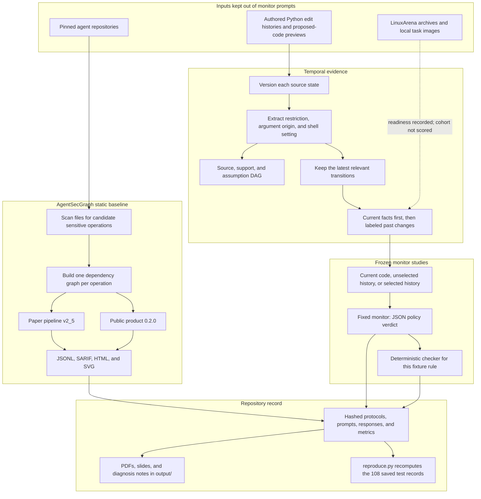

# Architecture

DeepTrace asks whether a fixed safety monitor judges a proposed code change more reliably when it also sees how security-relevant facts changed in earlier edits. The repository is the research record for that question, plus one offline script that recomputes the main selector-study table from saved model responses. It is not a deployed monitor, and the recorded studies do not establish that history improves detection.

## What the system does

Work starts from source, not from a running agent. AgentSecGraph, pinned to an unmodified AgentSecBench checkout, scans a repository for candidate sensitive operations and builds a small evidence graph for each one. Python dependencies come from the AST. JavaScript and TypeScript dependencies come from bounded lexical recovery. Two implementations stay separate: the paper pipeline `v2_5` and the public product `0.2.0`. Those graphs name sources, guards, and effects for one operation. They do not record that an imported authorization helper was weakened while the sink graph stayed the same.

The experiment tree supplies that missing history on authored Python fixtures. Each source state is a version. A bounded extractor records three facts for the single supported runner path: whether inputs are restricted, where the process argument comes from, and whether `shell=True`. The version-aware selector keeps the current proposed state first, then only the latest relevant past transitions, such as a weakening, a restoration, a removal, or an explicit unknown. If the packet exceeds its token budget, selection fails closed and returns no history packet. A later source-and-support DAG links claims to the file versions that support them. That DAG was added after the frozen monitor runs, so those scores do not evaluate it.

The monitor is a fixed model, mainly GPT-5 Nano through OpenRouter, asked for a JSON verdict under a shared evidence cap. The same current summary is present in every arm. Arms differ only in whether past changes are omitted, included unfiltered, or included after selection. A separate deterministic checker can apply the authored rule to the facts the model reports. That checker diagnoses this fixture. It is not a general sabotage detector.

Across qualification, one prompt clarification, a paired current-versus-history comparison, and the three-arm selector study, extra history did not earn a detection benefit. In the selector test, all three arms reported the current facts correctly on 36/36 cases. Raw policy verdicts were 20/36 for current evidence, 26/36 with unselected history, and 24/36 with selected history. Saved calibration thresholds then disabled every alarm. LinuxArena is the intended setting for real multi-step trajectories. Public archives and a local task image were checked later, but no cohort with a verified initial state and an independently checked first-harm boundary has been scored. `output/` holds the papers, slides, and diagnosis pages from these studies.

`reproduce.py` is the part of the repository that a new clone is expected to run. It hashes the saved selector-study inputs, recomputes the 108 test records, and checks the totals above. It does not call a model, rerun the selector, or regenerate source histories. GitHub Actions runs that script on Ubuntu and Windows for Python 3.10 and 3.13 when the reproduction files change.

## System diagram

The dotted LinuxArena edge is readiness only. Hidden task goals and scorer records stay out of monitor inputs. `reproduce.py` reads the saved selector-evaluation results. It does not rebuild the graphs or call the monitor again.

## Where the pieces live

| Path | Role |
| --- | --- |
| `research/agentsecgraph/` | Static scan, graph comparison, and the notes on what those graphs miss across edits |
| `research/deeptrace_experiments/scripts/` | Original temporal-graph and monitor pilots |
| `research/deeptrace_experiments/qualification/` | Evidence-packet repair and the first frozen model check |
| `research/deeptrace_experiments/monitor_repair/` | One prompt clarification, then a fresh qualification |
| `research/deeptrace_experiments/qualified_comparison/` | Paired current-code versus history comparison after qualification |
| `research/deeptrace_experiments/version_selector/` | Bounded selector over restriction, argument origin, and shell setting |
| `research/deeptrace_experiments/selector_evaluation/` | Frozen three-arm study and the inputs `reproduce.py` checks |
| `research/deeptrace_experiments/history_diagnosis/` | Offline split between reported facts and the policy verdict |
| `research/deeptrace_experiments/continuation/` | Later protocols, the support DAG, and the LinuxArena gate |
| `research/deeptrace_experiments/linuxarena_reassessment/` | Public-archive and local-container readiness notes |
| `research/deeptrace_experiments/decision/` | Decision to stop tuning the spent synthetic cases |
| `output/` | Reports, slides, and diagnosis pages |
| `reproduce.py`, `reproduction/`, `.github/workflows/reproduction.yml` | Offline check of the saved selector-study table |
